# CoinPig Class Map

此图描述当前 2D 游戏代码。正式冻结基线时应同步保存。

```mermaid
flowchart TB
  subgraph presentation[表现与交互]
    Workshop[Workshop 场景协调]
    Hammer[HammerSwing 蓄力与恢复]
    Bench[WorkbenchView 世界到屏幕的映射]
    Backdrop[WorkbenchBackdrop 桌面]
    Painter[PigPainter 猪的外观]
    Effects[StrikeEffects 颗粒与飘字]
    Audio[ImpactAudio 音效]
    UI[WorkshopUi 界面装配]
    HUD[WorkshopHud 营业信息]
    Menu[WorkshopMenu 菜单导航]
    Style[WorkshopStyle 样式]
    Snapshot[SessionSnapshot 只读显示数据]
    Text[GameText 结果文案]
  end
  subgraph core[引擎无关的游戏规则]
    Session[GameSession 回合与交易协调]
    Rent[RentContract 账单与支付进度]
    Rewards[SwingRewards 收益与每日限制]
    Inventory[ShopInventory 装备等级与购买校验]
    Skills[SkillProgress 技能前置和成长]
    IShop[IShop 商品查询与购买]
    ISkills[ISkillTree 技能查询与学习]
    Herd[PigHerd 猪群与命中查询]
    Motion[PigMotion 世界运动与重生]
    Pig[PigState 血量]
    Resolver[StrikeResolver 伤害结算]
    Result[SwingResult 单锤结果]
    Catalogs[GameRules 与各 Catalog 配置]
  end
  Workshop -->|has-a| Session
  Workshop -->|has-a| Bench
  Workshop -->|has-a| Hammer
  Workshop -->|has-a| UI
  Workshop -->|uses| Audio
  Workshop -->|creates| Snapshot
  Workshop -->|uses| Text
  Bench -->|has-a| Herd
  Bench -->|uses| Painter
  Bench -->|has-a| Backdrop
  Bench -->|has-a| Effects
  Herd -->|has-a| Motion
  Motion -->|has-a| Pig
  UI -->|has-a| HUD
  UI -->|has-a| Menu
  HUD -->|reads| Snapshot
  Menu -->|reads| Snapshot
  Menu -->|queries| IShop
  Menu -->|queries| ISkills
  HUD -->|uses| Style
  Menu -->|uses| Style
  Session -->|implements| IShop
  Session -->|implements| ISkills
  Session -->|has-a| Rent
  Session -->|has-a| Rewards
  Session -->|has-a| Inventory
  Session -->|has-a| Skills
  Session -->|uses| Resolver
  Resolver -->|damages| Pig
  Resolver -->|creates| Result
  Session -->|settles once| Result
  Session -->|uses| Catalogs
  Inventory -->|receives| Catalogs
  Skills -->|uses| Catalogs
```

## 职责边界

GameSession 协调合法回合、体力与统一钱包；RentContract 决定本期欠款和支付进度；SwingRewards 决定击碎收益与每日退款限制；ShopInventory 和 SkillProgress 验证各自的购买/解锁条件。失败操作不扣钱、不提升等级；已结算的落锤不能再次发放收益。

PigHerd、PigMotion 使用 System.Numerics.Vector2 的世界坐标，运动和重生可以在普通 .NET 程序中执行。WorkbenchView 负责将世界坐标映射到屏幕，不再把窗口大小写进猪的运动规则。PigPainter 和 StrikeEffects 分别负责造型和短暂反馈。

WorkshopUi 只装配界面。WorkshopHud 显示营业信息，WorkshopMenu 负责各页面和返回路径。菜单用 MenuPage 表示状态，修改标题不会改变 Esc 行为。商店与技能页查询 IShop、ISkillTree；普通显示只读取 SessionSnapshot，不持有可以修改钱包的 GameSession。

交易结果返回状态和金额，GameText 才决定中文提示。猪种规则不含颜色和 Godot 类型；颜色保存在 PigPainter 的外观配置中。配置条目的名称和描述作为展示元数据保留，避免为了拆分静态文字建立多余服务。

## 扩展与取舍

GameSession 可接收另一份商品目录；新商品使用已有效果字段时不修改购买流程。PigHerd 可接收另一组生成配置。增加全新技能或奖励机制仍可能需要改动对应规则类，不把数据配置等同于任意行为都无需修改。

没有真实继承关系时使用组合。IShop 和 ISkillTree 只有客户需要的能力，不要求空实现。现有奖励公式集中在 SwingRewards；若未来出现多种独立的奖励策略，再据实际变化引入合适的行为接口。

3D 转换预计替换桌面、猪外观、摄像机和空间命中适配，继续使用同一套回合、支付、成长、血量及猪群生命周期。尚未进行 3D 转换，不声称已验证这些预测。
